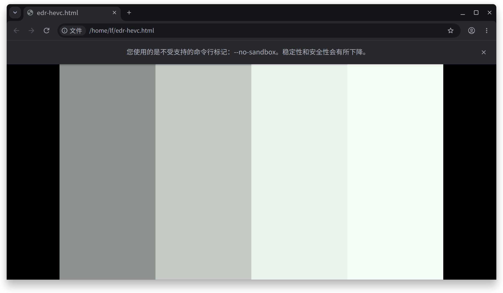

# mtgpu-chromium

> ⚠️ **必须与 [mtgpu-kde](https://github.com/yeungtuzi/mtgpu-kde) 配合使用。**
> EDR/HDR 依赖 `mtgpu-kde` 提供的 KWin 覆盖包（参考白策略、固定 1000 nit 客户端目标、BT.2390 滚降 LUT），
> 只装本项目的 Chromium 不会得到 EDR 效果。
>
> ⚠️ **仅在 AIBOOK 上验证**（MTT M1000 + OLED 面板 + KWin Wayland）。其他机型/面板未测试，
> 硬解与 EDR 行为可能不同（LCD 需要额外的背光 boost/恢复逻辑）。


在 AIBOOK（MTT M1000 / aarch64 / KWin Wayland）上从源码构建的 **Chromium 157.0.8103.38**，
针对 mtgpu 的硬件解码与 EDR（增强动态范围）做了验证和补强。

## 与预装 Google Chrome 的主要区别

| # | 区别 | 说明 |
|---|---|---|
| 1 | **mtgpu 硬件解码** | 用 M1000 的 VPU 解码视频，CPU 占用大幅下降。已验证 H.264 / HEVC / VP9 / AV1；AVS2 按厂商文档支持（8/10-bit、8K）。**预装 Chrome 播放 HEVC（如 B 站 HDR）时走的是软解**——能放，但 CPU 占用高、风扇明显；本构建改为走 VPU 硬解，默认开启，无需用户加 flag。 |
| 2 | **EDR（增强动态范围）** | 配合 [mtgpu-kde](https://github.com/yeungtuzi/mtgpu-kde) 的 KWin 覆盖包，在 AIBOOK 的 OLED 面板上把 **HDR1000 映射到 TrueBlack HDR500**（BT.2390 EETF，129 点 PQ LUT）：500 nit 内容映射到约 338 nit，1000 nit 内容到 500 nit，高光不再一刀切。**本地 HDR 视频与 B 站 HDR 视频播放正常。** |
| 3 | **完全去除 Google 功能的版本** | 基于 [ungoogled-chromium](https://github.com/ungoogled-software/ungoogled-chromium) 补丁集构建的去 Google 变体（无 Google 服务、无 Safe Browsing 上报、无 RLZ、无 Google API keys），以独立包/二进制发布，不影响系统 Chrome。 |
| 4 | **使用本地工具链从头编译** | 不是复用上游预编译产物，而是本机从源码完整编译：clang 21.1.8（`/usr/lib/llvm-21`，`mtgpu_legacy_clang=true`）+ rustc 1.100.0-nightly（Chromium 固定版本，由 [mtgpu-rust](https://github.com/yeungtuzi/mtgpu-rust) 构建提供，见 `third_party/rust-toolchain`）；另备有 [mtgpu-clang](https://github.com/yeungtuzi/mtgpu-clang)（clang 24）可切换。 |

## 其他区别（补充）

- **HEVC 解复用补丁**：本构建使用的 ffmpeg 配置里 `CONFIG_HEVC_DEMUXER` 默认为关闭，我们把它打开（并加入 `libavformat/hevc.c`、`hevcdec.c`），
  否则硬解没有可用的解复用入口。（预装 Chrome 的二进制自带 HEVC 解复用，所以它能软解播放。）
- **默认启用 VA-API 硬解并跳过驱动白名单**：Chromium 的 VA-API 解码默认面向 Intel 驱动，
  MTT 驱动不在白名单内；本构建默认走 `VaapiVideoDecoder + VaapiIgnoreDriverChecks`，
  开箱即用，不需要用户记命令行参数。
- **EDR 诊断开关**：`CHROME_EDR_DEBUG=1` 会打印 `[EDR]` 系列日志（headroom、quad 色彩空间、
  `is_video`、`targeted_headroom` 与 `display_headroom` 是否一致），便于确认 EDR 是否真正生效。
- **与 KWin 补丁配套**：EDR 不是单靠浏览器实现的——需要 [mtgpu-kde](https://github.com/yeungtuzi/mtgpu-kde)
  中的 KWin 覆盖包（固定 1000 nit 客户端目标、参考白随亮度条、BT.2390 LUT），两者版本要配套。
- **独立安装，不与系统 Chrome 冲突**：装在 `/opt/mtgpu-chromium`，`/usr/bin/mtgpu-chromium`
  启动器 + 桌面项；系统 `google-chrome-stable` 保持不变。
- **可复现构建**：源码 commit、工具链（clang 21.1.8 + rustc 1.100.0-nightly）、gn args 与补丁均记录在仓库中。
- **无 Google 更新组件常驻**：单一 release 构建，不跑 Google 更新服务，更新靠包管理器手动完成。
- **不含 Widevine DRM**：Netflix、Spotify 等受 DRM 保护的内容无法直接播放（可另行安装 Widevine CDM）。
- **不含 Google API keys**：依赖 Google 服务的功能（定位、部分账号相关能力）会降级或不可用；
  去 Google 变体则连内置的 Google 服务入口一并移除。

## 安装

```sh
sudo apt install ./mtgpu-chromium_157.0.8103.38_arm64.deb
mtgpu-chromium https://example.com
```

- 安装路径 `/opt/mtgpu-chromium`，启动器 `/usr/bin/mtgpu-chromium`，桌面项 `Chromium (mtgpu, HDR)`。
- 运行时不修改、不依赖 `google-chrome-stable`。

## 实测数据

硬解（`mthreads-gmi -q` 的 `Utilization → Decoder`，长采样取峰值）：

| 编码 | 驱动声明 VA-API | mpv `Using hardware decoding (vaapi)` | Chrome 中 VPU 峰值 |
|---|---|---|---|
| H.264 | ✅ | ✅ | 7.2% |
| HEVC | ✅ | ✅ | 5.5% |
| VP9 | ✅ | ✅ | 3.3% |
| AV1 | ✅ | ✅ | 3.4% |
| AVS2 | ✅（厂商文档） | 无样本未测 | — |

1080p H.264 对比：**硬解时 Chrome 总 CPU ≈ 3.8%**，软解 ≈ **85.8%**（约 22 倍差距）。

EDR（`CHROME_EDR_DEBUG=1`）：

```
[EDR] wp_image_description sdr=178 target_max=1000
[EDR] swap headroom=1.49 sdr_nits=178        # log2，即 2.8x
[EDR] quad src={primaries:BT2020, transfer:PQ (white:203 nits)} is_video=1
```

KWin 侧（mtgpu-kde 补丁）在 100% 与 40% 亮度下都保持 `tonemap=1 maxWhite=1000 maxOut=500`。

## 验证截图



上图是 `hdr-bars.mp4`（四段 100 / 203 / 500 / 1000 nit，HEVC Main10 PQ）在 **40% 亮度**下的实际播放截图，
用于验证 **BT.2390 亮度滚降映射**：1000 nit 档没有在 500 nit 处被一刀切，而是经 EETF 压缩到面板峰值，
观感接近 **TrueBlack HDR500**。

注意：截图经过 `spectacle` 的 SDR 抓取路径，高光会被再压缩一次，**只能证明"存在滚降"，不能当亮度计**；
实际观感比截图更接近 HDR。素材与探测脚本见
[mtgpu-kde/tools/chromium-hdr](https://github.com/yeungtuzi/mtgpu-kde/tree/main/tools/chromium-hdr)。

## 已知限制

- **HDR 视频亮度仍会部分跟随亮度条**：100% 时 SDR 白到达面板峰值，500 nit 高光与白点重合，
  最后两档会合流；接近 0% 时高光也会变暗。EETF 本身固定，剩余依赖来自 SDR 合成混合阶段。
  **推荐观看 HDR 时把亮度调到 40–50%（约 200–250 nit SDR 白）**，该区间四档区分最清楚。
- Qt 文件对话框走 xdg-desktop-portal（构建时 `use_qt6=false`）。
- 对 HDR 视频截图会全黑（硬件叠加层不参与截屏），是采集限制，不是 EDR 失效。
- 真正的 HDR 输出模式（`highDynamicRange: true`）仍依赖厂商完善 GPU 驱动与面板参数；
  当前 EDR 是在 SDR 输出模式下用人工 headroom 实现。

## 构建

见 [mtgpu-kde 的 TOOLCHAIN.md](https://github.com/yeungtuzi/mtgpu-kde/blob/main/tools/chromium-hdr/TOOLCHAIN.md)：
`gn gen out/hdr` + `ninja -j12 chrome`；ffmpeg 的 HEVC demuxer 开关在
`third_party/ffmpeg/chromium/config/Chrome/linux/arm64/config_components.h`。

---

## English summary

Chromium 157.0.8103.38 built from source for the M1000 (aarch64, KWin Wayland),
adding what the stock Google Chrome Linux build lacks:

1. **mtgpu hardware decode** — H.264 / HEVC / VP9 / AV1 verified on the VPU
   (AVS2 per vendor docs), enabled by default. Stock Chrome *can* play HEVC
   (e.g. Bilibili HDR) but does so in software, burning CPU and spinning the
   fan; this build routes it through the VPU instead.
2. **EDR** — with the [mtgpu-kde](https://github.com/yeungtuzi/mtgpu-kde) KWin
   overlay it maps HDR1000 onto the AIBOOK OLED's TrueBlack HDR500 peak
   (BT.2390 EETF, 129-entry PQ LUT); local and Bilibili HDR playback work.
3. **De-Googled variant** — built from the
   [ungoogled-chromium](https://github.com/ungoogled-software/ungoogled-chromium)
   patch set, shipped as a separate package.

Also: HEVC demuxer patch, VA-API enabled by default with driver-check bypass,
`CHROME_EDR_DEBUG=1` diagnostics, isolated install under `/opt/mtgpu-chromium`.

Known limitation: HDR brightness still partly follows the brightness slider;
40-50 % is the recommended window for HDR viewing.

## 2026-11-13 更新：EDR 已不依赖本项目的客户端补丁

`mtgpu-kde` 新增了 KWin 侧改动（[`patches/kwin-6.8.2-edr-advertise-1000.patch`](https://github.com/yeungtuzi/mtgpu-kde/blob/main/patches/kwin-6.8.2-edr-advertise-1000.patch)）：
把 `wp_image_description` 通告的 **HDR 最大值下限提升到 1000 nit**，由合成器把 1000 nit 内容按 BT.2390 压到 500 nit 面板。

实测结果（同一台 AIBOOK）：

| 浏览器 | VPU 硬解 | EDR |
|---|---|---|
| **预装 Google Chrome** | ✅ 默认 | ✅ |
| **Brave 1.99.57（Chromium 157）** | ✅ 默认（2.8–6.0%） | ✅ |
| 本项目编译的 mtgpu-chromium | ✅ | ✅ |

证据：`EDRK shader tonemap=1 maxWhite=1003.2 maxOut=500.0 tf=2`。

因此：
- **只为 EDR 的话，不再需要自己编译 Chromium**，装 `mtgpu-kde` 即可；
- 本项目的价值集中在 **去 Google（ungoogled）与完全可控**；
- ungoogled 版本的全量构建**已中止**（2026-11-13，`[9837/57801]`，0 错误），需要时可按 `chromium-hdr/TOOLCHAIN.md` 的官方参数重建。

